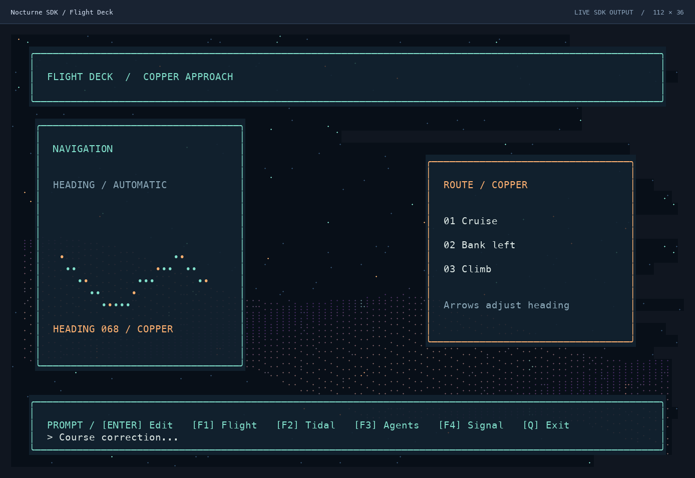

# Nocturne component SDK

Nocturne is a software development kit for composing dynamic terminal interfaces
from reusable components and documented contracts.

The SDK provides animation, 2D path movement, Unicode 17 text layout,
styled text, color and image sampling, subcell drawing and offscreen layers.
Mount custom and stock components in rows, columns, stacks, panels and
scrolling viewports. A frame sink presents the result as plain text or ANSI.
Terminal adapters connect the tree to POSIX and Windows consoles. Optional
packages add graph composition, spatial geometry and surface simulation.
[Install and compatibility](docs/COMPATIBILITY.md) · [Language bindings](docs/BINDINGS.md)

## Runnable examples

[](docs/gallery/flight.png)

The [scene-gallery example](examples/scene-gallery/README.md) runs Flight Deck,
Tidal Console, Signal Desk, and an agent workspace with streamed text and
file diffs. Browse the [HTML example gallery](docs/gallery/index.html) locally
for captures and clips, or open the [visual coverage index](docs/gallery/COVERAGE.md)
to see component examples and outstanding RC5 ports.

## Build and run

Requires a C99 compiler and CMake 3.20 or newer. The core uses the target's
C and math runtimes. The commands below run the POSIX motion example.

```sh
cmake -S . -B build -DCMAKE_BUILD_TYPE=Debug
cmake --build build
ctest --test-dir build --output-on-failure
./build/nocturne_motion 750
./build/nocturne_motion --animate
```

The first example command prints a plain frame at 750 milliseconds. `--animate`
runs a six-second terminal demonstration; Ctrl-C exits and restores the screen and cursor visibility.
Its two custom labels use independent paths and brightness tracks, while a
keyframe track drives a progress indicator.

## Use the components

```c
#include <nocturne/animation.h>
#include <nocturne/motion.h>

const NtPoint points[] = {{0, 0}, {30, 0}, {30, 10}};
NtPath path = {points, 3, 0, NT_ONCE};
NtTween movement = {0, 40, 1000000, 0, NT_LINEAR, NT_ONCE};
NtAnimationSample distance;
NtPathSample position;

/* The application supplies time and chooses what property to update. */
if (nt_tween_sample(&movement, 875000, &distance) == NT_OK &&
    nt_path_sample(&path, distance.value, &position) == NT_OK) {
    /* position.position is (30, 5): apply it to any application object. */
}
```

Use `<nocturne/timeline.h>` to compile a sequence or parallel group of
scalar tracks. Assign tracks to application channels and sample from
`NtPlayback` or an explicit elapsed time. The same API provides bounded
rates, quantized clocks, dwells, skips, and deterministic random tracks
and stagger schedules. [Timeline contract](docs/CONTRACTS.md#timelines-and-track-modifiers) ·
[Installed timeline consumer](tests/consumer/timeline.c)

Use `NtSpring` to animate a scalar property with a critically damped
response. Retarget with the displayed position and velocity preserved,
reset velocity at the same position, or settle immediately. Reduced motion
samples the target with zero velocity. [Spring contract](docs/CONTRACTS.md#springs-and-retargeting) ·
[Installed spring consumer](tests/consumer/spring.c)

`<nocturne/text.h>` validates counted UTF-8 and visits extended grapheme clusters
as byte spans, using caller-owned iterator state. The installed C consumer
exercises it with a combining mark and an emoji ZWJ sequence.

Use `nocturne/text_layout.h` to measure mixed text without a scene or terminal.
This layout borrows the source for its lifetime, uses four-column tab stops
and constrains word wrapping to 20 columns. The resulting records expose
visual positions and original UTF-8 byte spans. Use `nocturne/frame.h`
when you need mutable cell storage with wide-glyph continuations.

```c
#include <nocturne/text_layout.h>

const char source[] = "Hello \xe4\xb8\xad \xd7\x90\xd7\x91";
const NtTextLayoutOptions options = {
    .width = {NT_WIDTH_ONE, NT_WIDTH_TWO},
    .bounds.columns = {0, 20, true},
    .wrap = NT_WRAP_WORD,
    .align = NT_TEXT_ALIGN_START,
    .base_direction = NT_DIRECTION_AUTO,
    .tab_stop = 4
};
NtTextLayout *layout;
if (nt_text_layout_create_borrowed(NULL, (NtByteView){source, sizeof(source) - 1},
                                   &options, &layout) == NT_RESULT_OK) {
    NtCellSize size = nt_text_layout_size(layout);
    /* Use size and the visual glyph records to position content. */
    (void)size;
    nt_text_layout_destroy(layout);
}
```

[Layout and caret contracts](docs/CONTRACTS.md#terminal-text-layout-and-caret-mapping)

Use `nocturne/text_effect.h` to reveal, move and substitute whole graphemes
with an explicit clock. [Animated text contract](docs/CONTRACTS.md#animated-text-effects) ·
[Text effect recipes](docs/TEXT-RECIPES.md)

Use `nocturne/panel_transform.h` to move, scale and rotate offscreen content
through fixed clips and animated masks. [Panel projection contract](docs/CONTRACTS.md#panel-projection-and-transitions) ·
[Panel transition recipes](docs/PANEL-RECIPES.md)

Use `nocturne/text_paint.h` to paint spans onto a clipped surface. Use
`nocturne/content.h` for caller-supplied cells and image textures, and
`nocturne/present.h` to send a frame to a host. The installed presentation
consumer moves a retained Unicode text layer through a viewport and
draws a braille line. With tmux available, the presentation gate builds
the consumer from a relocated installation and captures both placements
from real terminal output.

```sh
python3 tools/check_presentation.py build
```

Use `<nocturne/binding.h>` to apply typed inputs and computed values to
stock or custom component properties. A binding prepares every target
before committing the changes, and a removed component makes its graph
stale. [Binding contract](docs/CONTRACTS.md#typed-properties-and-explicit-bindings) ·
[Installed binding consumer](tests/consumer/binding.c)

Use `<nocturne/style.h>` to resolve state, role, ancestry and Unicode
text selectors. Apply matching values to chosen component properties or
paint foreground and background rules over logical text regions.
[Stylesheet contract](docs/CONTRACTS.md#stylesheets-states-and-text-regions) ·
[Installed style consumer](tests/consumer/style.c)

Use `<nocturne/event_rules.h>` in a component event callback to match the
event and routing phase, test a predicate against typed properties, and
derive application intent fields. Drain typed and byte intents from the
same tree queue. [Event rules contract](docs/CONTRACTS.md#event-rules-and-typed-intents) ·
[Installed event rules consumer](tests/consumer/event_rules.c)

Use `<nocturne/property.h>` to apply explicit atomic assignments,
`<nocturne/schedule.h>` for deadline-ordered batches and mount-scoped
intent receivers, and `<nocturne/state.h>` to capture and restore versioned
property snapshots. [Scheduling contract](docs/CONTRACTS.md#scheduled-batches-and-scoped-subscriptions) ·
[Snapshot contract](docs/CONTRACTS.md#versioned-property-snapshots) ·
[Installed state update consumer](tests/consumer/state_update.c)

Use `<nocturne/plot.h>` for bars, pie and donut charts, scatter and line
plots, independent edges, and signed fixed-point digits. The mount owns
its data and uses the component's assigned viewport. [Plot contract](docs/CONTRACTS.md#plot-and-numeric-components) ·
[Installed plot consumer](tests/consumer/plot.c)

Use `<nocturne/graph.h>` with `Nocturne::graph` to arrange caller-supplied
nodes and edges in layered, radial or force-directed layouts. The mounted
view supports pinning, Unicode labels and selection by stable ID.
[Graph contract](docs/CONTRACTS.md#graph-layout-and-mounted-graph-view) ·
[Installed graph consumer](tests/consumer/graph_workflow.c)

Use `<nocturne/window.h>` for floating, docked and animated panels, and
`<nocturne/notification.h>` for expiring notifications and persistent
status cards. Windows can host ordinary components or a caller-authored
panel content provider.
[Window contract](docs/CONTRACTS.md#window-workspace-and-panel-content-providers) ·
[Notification contract](docs/CONTRACTS.md#notifications-and-persistent-status-cards)

Use `<nocturne/particle.h>` for seeded emission, explicit-time particle
motion, bounded trails, and a mounted view with reduced-motion support.
[Particle contract](docs/CONTRACTS.md#seeded-particle-emission-motion-and-trails) ·
[Installed particle consumer](tests/consumer/particles.c)

Use `<nocturne/particle_effect.h>` for configurable bursts, nova,
glitter, rain, snow, embers, leaves, sparks and fireworks. Sample or draw
seeded visual branches at the same explicit caller time as other components.
[Effect contract](docs/CONTRACTS.md#visual-particle-recipes-and-branches) ·
[Installed effect consumer](tests/consumer/particle_effects.c)

Use `<nocturne/field.h>` to sample timed ripples and analytic waves for
motion or palette color, or draw the result into clipped cell backgrounds.
[Field contract](docs/CONTRACTS.md#optical-fields-ripple-trains-and-analytic-waves) ·
[Installed field consumer](tests/consumer/fields.c)

Use `<nocturne/particle_deposits.h>` to aggregate timed contacts into
cell piles and release seeded particles from them. The Aurora Survey
consumer composes fields, particles and moving Unicode text with an
editor, a selectable graph and a plot in a live terminal.
[Deposit contract](docs/CONTRACTS.md#deposits-piles-and-re-emission) ·
[Composed consumer](tests/consumer/visual_terminal.c)

## Install and consume

```sh
cmake --install build --prefix "$PWD/install"
```

A separate project's `CMakeLists.txt` can use:

```cmake
find_package(Nocturne 1.0 CONFIG REQUIRED)
target_link_libraries(my_app PRIVATE Nocturne::nocturne)
```

Configure that project with `-DCMAKE_PREFIX_PATH=/absolute/path/to/install`.
The package contains public headers, a static library, CMake metadata and the
SDK and Unicode licenses. It builds and installs from this checkout alone.

For 3D vectors, affine transforms, paths, camera poses, projection, clipping,
picking, mesh rendering, surface poses and swept contact queries, request
the `spatial` component and link
`Nocturne::spatial`.

```cmake
find_package(Nocturne 1.0 CONFIG REQUIRED COMPONENTS spatial)
target_link_libraries(my_app PRIVATE Nocturne::spatial)
```

Configure the SDK with `-DNOCTURNE_BUILD_SPATIAL=OFF` to omit that extension.
[Spatial contract](docs/CONTRACTS.md#spatial-transforms-paths-and-cameras)
· [Mesh and raster example](tests/consumer/spatial_mesh.c)
· [Surface motion and contact example](tests/consumer/spatial_surface.c)
· [Model Bench terminal example](examples/model-bench/README.md)

For waves, channel flow, thickness, spray, and water, foam and heat transport, include
`<nocturne/simulation.h>`. Request the `simulation` CMake component
and link `Nocturne::simulation`. Simulation can be disabled with
`-DNOCTURNE_BUILD_SIMULATION=OFF`. It depends on the spatial extension.
[Simulation contract](docs/CONTRACTS.md#water-waves-channel-flow-and-spray)
· [Flow consumer](tests/consumer/surface_flow.c)
· [Transport consumer](tests/consumer/surface_transport.c)

To verify installation with fresh C and C++ consumers in a temporary directory:

```sh
python3 tools/check_install.py build
```

The real terminal example can be checked in a pseudo-terminal for normal
completion and interrupted cleanup with `python3 tools/check_terminal.py`.

To run native contract checks with address and undefined-behavior sanitizers:

```sh
cmake -S . -B build-sanitize -DNOCTURNE_SANITIZE=ON
cmake --build build-sanitize
ctest --test-dir build-sanitize --output-on-failure
```

## Custom components

`<nocturne/component.h>` exposes mounted state, explicit updates and
deadlines, child measurement and placement, and transactional frame
publication. Consumer components use the same callbacks throughout the
tree. See the [installed C consumer](tests/consumer/component.c) for an
animated component, and the [component contract](docs/CONTRACTS.md#component-tree-and-publication)
for ownership and error behavior.

Use `<nocturne/layout.h>` for row, column and stack layout,
`<nocturne/viewport.h>` for clipped scrolling and anchors, and
`<nocturne/widgets.h>` for labels, panels and rules. The installed consumer
rearranges the same components in two layouts and links its custom indicator
as a separate translation unit. [Installed composition](tests/consumer/composition.c)

On POSIX, link `Nocturne::posix_host` and include `<nocturne/posix_host.h>`
to let the adapter own a tty. Open the host with the terminal capabilities
and your clock's starting time, call `nt_posix_host_step` from your event
loop, and close the host before handing the terminal back. A step drives
component updates, key and pointer dispatch, terminal resize, and rendering.
Use the same portable tree and frame APIs with a different host if your
application already owns the terminal. [POSIX host contract](docs/CONTRACTS.md#posix-terminal-host)

`nt_posix_terminal_probe` suggests color, glyph and input settings for the
available descriptors. When output is redirected, use the reported capabilities
with `NtAnsiPresenter` to emit plain text. The installed profile consumer shows
both paths, with an explicit motion preference. [Capability and fallback example](tests/consumer/terminal_profile.c)

Use `<nocturne/editor.h>` for an owned editor buffer with grapheme-aware
selection, movement and replacement. Create a layout from the buffer to
map clicks and caret positions in wrapped or bidirectional text.
[Editor contract](docs/CONTRACTS.md#editor-buffer-and-grapheme-selection) · [Installed editor consumer](tests/consumer/editor.c)

Set editor limits to use undo and submitted history. Pass a caller-owned
key map to bind commands and optionally share a register bank across
editors. Text and paste input also work with an empty key map.
[Undo and history contract](docs/CONTRACTS.md#editor-undo-and-submitted-history) · [Key-map and register contract](docs/CONTRACTS.md#opt-in-editor-key-maps-and-registers)

Mount buttons, items, choices, and indicators through `<nocturne/controls.h>`.
Drain typed changes with `nt_control_event_decode` and keep application actions
in the consumer. Mount an editor view in a panel for framed input, or use a
read-only buffer for a scrollable reader.
[Basic controls contract](docs/CONTRACTS.md#basic-controls-and-typed-intents) · [Installed controls consumer](tests/consumer/controls.c)

Build and run Field Log against the installed SDK to try editable input,
keyboard focus, a selectable list, progress, a scrollable reader and
an animated custom component.
[Quickstart](docs/QUICKSTART.md) · [Control reference](docs/CONTROL-REFERENCE.md) · [Custom component tutorial](docs/CUSTOM-COMPONENT.md)

## SDK documentation

- [Installation and compatibility](docs/COMPATIBILITY.md)
- [Component catalog](docs/COMPONENTS.md)
- [Public contracts](docs/CONTRACTS.md)
- [Language bindings](docs/BINDINGS.md)
- [Release builds and package contents](docs/RELEASES.md)
